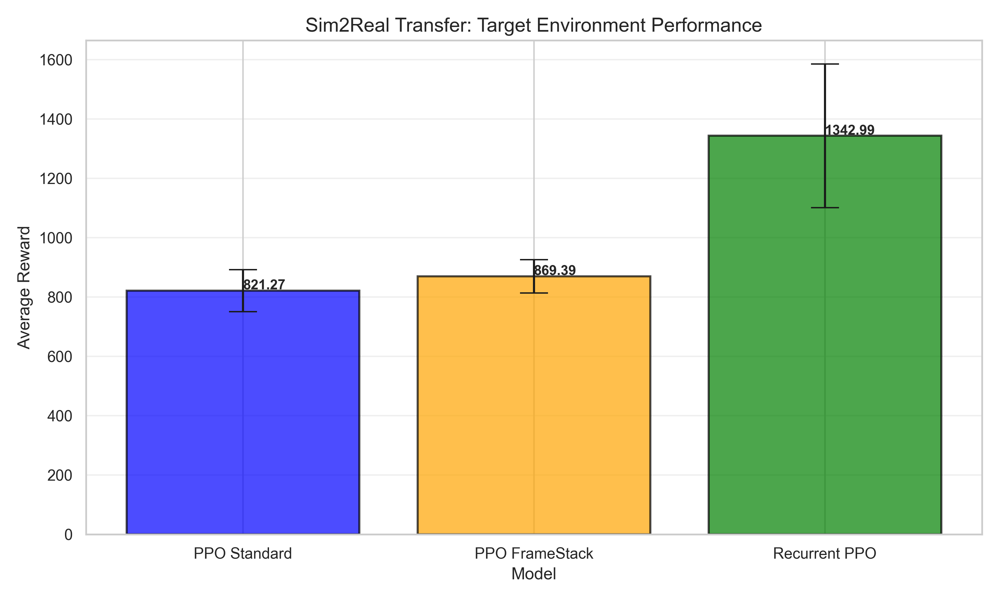
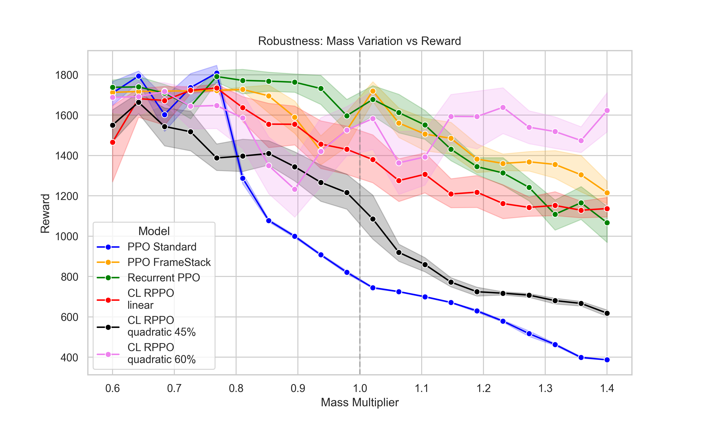

# Robust Robot Control with Reinforcement Learning

Deep reinforcement learning agents that keep a simulated robot moving when its body changes in ways they cannot observe.

Team project for the Robot Learning course at Politecnico di Torino.

## The problem

A policy trained in simulation often fails when the dynamics change. We study this on the MuJoCo Hopper: the agent is tested in a target environment whose torso mass it has never seen and cannot measure. Both source and target are simulated, so this is a sim-to-sim setup.

## What we built

- **Four kinds of agents**, trained with Stable-Baselines3 and compared on the same task: PPO, PPO with frame stacking, Recurrent PPO (LSTM), and Recurrent PPO with curriculum learning.
- **A curriculum environment** that widens the domain randomization range during training, with linear and quadratic schedules.
- **A full pipeline** for parallel training, evaluation and sensitivity analysis over a range of torso masses.

## Results

**Memory pays off.** In the target environment, the LSTM policy reaches an average reward of 1343, against 821 for the PPO baseline (+63%).



**Curriculum learning helps at the extremes.** With a quadratic schedule up to a 60% range, the agent keeps a high reward at the heaviest masses, where the other policies degrade. It does not beat plain Recurrent PPO in the target environment, and it dips around lighter masses.



## Run it

Requires Python 3.10 or later.

```bash
pip install -r requirements.txt
python training_multicpu.py    # train the agents (trained_models/, training_logs/)
python evaluate_training.py    # plot training curves (training_results/)
python testing.py              # test the agents (test_results/)
```

Trained models are not included, so run the training first.

## Repository layout

```text
training_multicpu.py                 training of all the agents
evaluate_training.py                 training curves
testing.py                           target environment and sensitivity tests
curriculum_learning_range_growth.py  plot of the curriculum schedules
env/                                 Hopper environments, including the curriculum one
udr_40_torso_locked/                 results with randomized masses and a fixed torso
udr_25_all_cl_40/                    results with all masses randomized and curriculum learning
```

## Authors

Matteo Flores, Andrea Germano, Riccardo Givogre.

## Credits

The Hopper environment extends starter code from the course, and `env/assets/hopper.xml` derives from the OpenAI Gym model. Built with Gymnasium, MuJoCo, Stable-Baselines3 and sb3-contrib.
